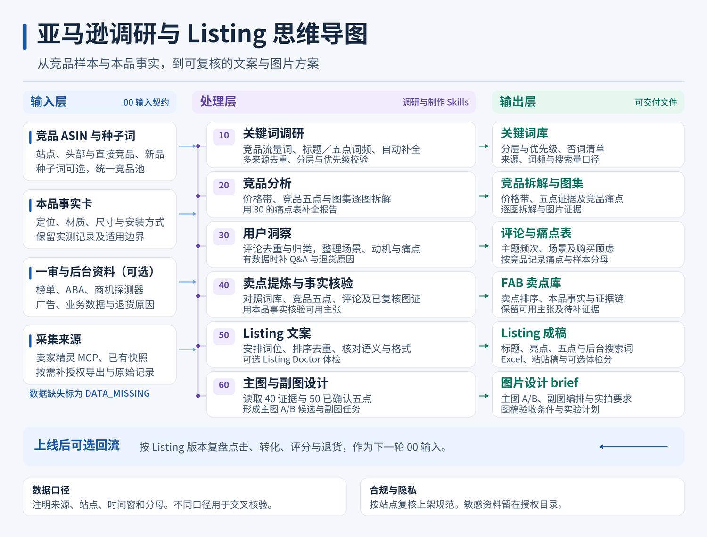

# Amazon 调研 Skills

面向亚马逊运营的文件驱动调研流程。从竞品和本品事实输入出发，交付关键词库、竞品与用户洞察、可追溯卖点、Listing 文案和图片设计 brief。采集和语义判断由支持 MCP 的代理执行，Python 脚本负责转换、计算、校验和出表。

## 项目思维导图

[](docs/amazon-listing-workflow.png)

10 关键词与 30 评论可并行准备。20 读取 30 的痛点表后出完整竞品报告。40 将证据与本品事实核对，50 交付成稿后，60 结合已确认五点与图片证据制作设计 brief。上线数据可按版本回流到下一轮 00。

## 模块与交付

| 模块 | 输入与交付 |
| --- | --- |
| [00 输入](SKILLS/modules/00-input/README.md) | 站点、分组 ASIN、本品事实卡和可选的后台及一审资料。每组数据保留样本、期次与来源 |
| [10 关键词](SKILLS/modules/10-keyword/SKILL.md) | 合并竞品流量词、标题和五点词频、自动补全和后台数据，输出分层词库与交付自检 |
| [20 竞品](SKILLS/modules/20-competitor/README.md) | 输出价格带、竞品五点和痛点。图片子流程使用 `keepa_info` 获取图集，经人工或视觉模型逐图判读 |
| [30 洞察](SKILLS/modules/30-insight/README.md) | 评论合并、语义标注、词频、主题和 ASIN 痛点。Q&A 与退货需要对应数据，回放时记录覆盖范围 |
| [40 卖点](SKILLS/modules/40-selling-point/SKILL.md) | 结合竞品五点、评论和关键词，输出事实核验、FAB 卡及证据链。已复核的图证据可另行合并 |
| [50 文案](SKILLS/modules/50-copy/SKILL.md) | 选点、排序、生成、做语义和格式检查。交付可粘贴文本、Excel 和可选体检分 |
| [60 图片 brief](SKILLS/modules/60-image-brief/README.md) | 主图 A/B 候选、副图任务、实拍验收和实验计划。需要证据与人工验收，含 Excel 模板 |

`SKILLS/modules/` 描述输入输出和业务规则，`SKILLS/scripts/` 支撑离线转换和校验。`SKILLS/skills/` 和 `SKILLS/amz-review-analysis/` 保留可复用的上游技能。跨模块以文件和证据定位交接。

## 快速开始

建议使用 Python 3.12，在仓库根目录执行。

```bash
python -m pip install pyyaml openpyxl pytest
python -m pytest -q

python SKILLS/scripts/merge.py <项目目录>
python SKILLS/scripts/check.py <项目目录>

python SKILLS/scripts/check_copy.py --category <项目目录名>
python SKILLS/scripts/score_copy.py --category <项目目录名>
python SKILLS/scripts/build_copy.py --category <项目目录名> --sku <SKU>
```

文案脚本按各模块配置从 `调研/<项目目录名>/` 读取输入。联网采集按所用 MCP 配置 `SORFTIME_API_KEY`、`SELLERSPRITE_API_KEY`、`SIF_API_KEY` 或 `XIYOU_API_KEY`。部分上游联网脚本需要 `requests`。图集采集需要安装 `Pillow`，并确保命令行可以调用 `curl`。Listing Doctor 本地运行，评分用于辅助审阅。

## 数据口径与隐私

- 一审的榜单、评分、价格带、搜索、评论、退货和原型验证按 [00 输入契约](SKILLS/modules/00-input/README.md#4-一审调研资料回流可选)补入。每份材料标注站点、时间窗、样本和来源。比例附分子与分母。
- 销量与销售额标明估算来源。星级分布分别标注按 ASIN 计数还是按评分数加权。月度搜索估算、周搜索表现和 360 天商机探测器指标各保留自己的窗口。
- 市场证据用于提出机会和用户问题。本品文案或图片中的规格、性能、使用限制由本品事实和实测支持。上线后按 Listing 版本回收转化、评分和退货数据。
- Git 仅收录可公开复用的代码、通用模板与合成测试样本。公司与品牌标识、业务报表、原始评论和图片、内部链接、供应商、价格成本与实际 SKU 保存在授权项目目录。提交前检查文本、文件名、Excel 隐藏表和文档元数据。曾提交的凭据应撤销并轮换。仓库历史的清理由管理员按 GitHub 指引执行。 [GitHub 敏感数据清理指引](https://docs.github.com/en/authentication/keeping-your-account-and-data-secure/removing-sensitive-data-from-a-repository)

## 完整一轮的模型预算

以单 SKU、约 30 个竞品、300 条去重评论和 40–50 张重点竞品图片为例。脚本负责统计和出表，模型读取证据切片并处理语义判断、文案与设计 brief。累计预计 **输入 22.3–43.0 万、输出 4.6–9.2 万 token**。按 2026-11-20 的 `deepseek-flash` 价格，输入全部缓存未命中时约 **¥0.81–1.60（高峰）或 ¥0.41–0.80（空闲）**。预留 20%–35% 重跑后约 **¥0.98–2.15（高峰）或 ¥0.49–1.08（空闲）**。该预算来自工作量估算，实际用量按模型 API 的 `usage` 汇总。第三方采集订阅、独立 OCR 或图片制作另计。 [DeepSeek 人民币价格](https://api-docs.deepseek.com/zh-cn/quick_start/pricing/) · [Token 与图片计量](https://api-docs.deepseek.com/quick_start/token_usage/)

## 参考文献与源项目

- Amazon 官方数据口径和实验方法。 [Brand Analytics](https://sell.amazon.com/tools/amazon-brand-analytics) · [Product Opportunity Explorer](https://sell.amazon.com/tools/product-opportunity-explorer) · [Manage Your Experiments](https://sell.amazon.com/blog/manage-your-experiments)
- Amazon 商品图片规格与站点规则。 [Product image requirements](https://sellercentral.amazon.com/help/hub/reference/external/G1881)
- 上游调研方法和 Listing 工作流。 [Amazon-Skills-Liang](https://github.com/liangdabiao/Amazon-Skills-Liang) · [Amazon Skills 中的卖点验证](https://github.com/zach22-1999/amazon-skills)
- 评论分析与 Listing 体检。评论技能按上游自定义许可使用，使用和分发前核对 LICENSE。Listing Doctor 按 MIT 许可使用，版本和口径见仓库内 `SOURCE.md`。 [amz-review-analysis-skill](https://github.com/CoderAndyLee/amz-review-analysis-skill) · [amazon-listing-doctor](https://github.com/buluslan/amazon-listing-doctor)
- 竞品逐图分析与设计 brief 思路。 [slime-amazon-design-skill](https://github.com/knight9629/slime-amazon-design-skill) · [nexscope-ai/Amazon-Skills](https://github.com/nexscope-ai/Amazon-Skills)
